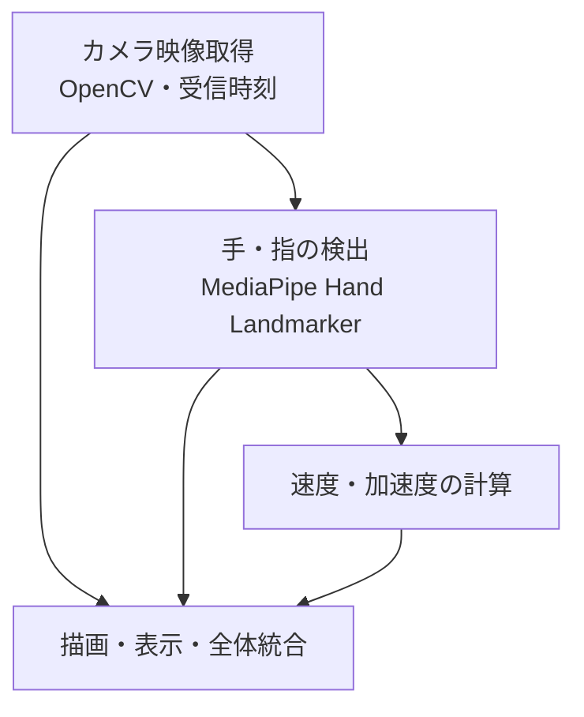

# 設計書（初版）

> 対象：カメラ映像から手・指の位置・速度・加速度を取得する機能  
> 状態：実装に合わせて更新する設計方針．検出結果・運動計算結果の共通型は定義済み．
> 根拠：[Issue #4](https://github.com/marmotech/gosz_hand-motion-tracker/issues/4) と共通仕様①〜⑥の決定コメント．

## 1. 目的と対象範囲

カメラ映像からMediaPipe Hand Landmarkerで手の動きを検出し，左右各手の全21点のランドマークの位置・速度・加速度を画像上の2D量として取得し，表示で確認できるようにする．ピアノ演奏中の手・指の動きを観察することを想定する．

初版の対象は以下とする．

- カメラ映像と取得時刻の記録
- 左右両手の21点のランドマーク検出と5本の指先の識別
- 左右各手の全21点の2D位置・速度・加速度の計算
- ランドマークと計算結果の描画・表示

実空間での3D位置・速度・加速度，平滑化，計測結果の永続保存は初版の範囲外とし，必要に応じて別途検討する．

## 2. 処理構成



| 担当 | 責務 | Issue |
|---|---|---|
| カメラ取得 | フレーム取得，受信時刻記録，カメラ解放 | [#5](https://github.com/marmotech/gosz_hand-motion-tracker/issues/5) |
| 検出 | 両手のランドマーク取得，左右・指先の識別，検出失敗の扱い | [#6](https://github.com/marmotech/gosz_hand-motion-tracker/issues/6) |
| 運動計算 | 全21点の速度・加速度，未計算値，最後の有効値の管理 | [#7](https://github.com/marmotech/gosz_hand-motion-tracker/issues/7) |
| 表示・統合 | 画像への描画，数値表示，各処理の結合，実行手順 | [#8](https://github.com/marmotech/gosz_hand-motion-tracker/issues/8) |

上図は論理的なデータの流れであり，クラス構成やファイル分割を指定するものではない．

## 3. 検出対象と座標系

- 両手に対応し，左右はMediaPipeのhandednessを利用して区別する．初版では独自の追跡・同一性判定は行わない．
- 手ごとに全21点のランドマークを取得し，各点を名前で参照できるようにする．親指・人差し指・中指・薬指・小指の指先もその一部として識別する．
- 計算には入力画像の2D座標を使う．原点は左上，右が+x，下が+y．
- 位置は浮動小数点のpx，速度はpx/s，加速度はpx/s²とする．
- 表示時に画像を縮小・左右反転する場合は描画座標を変換するが，計算用座標には影響させない．
- 現在と過去の位置は，同じ座標系・単位で比較する．

出典：[共通仕様①](https://github.com/marmotech/gosz_hand-motion-tracker/issues/4#issuecomment-6413161335)，[共通仕様②](https://github.com/marmotech/gosz_hand-motion-tracker/issues/4#issuecomment-6413408596)．

## 4. 時刻と経過時間

- フレーム取得に成功した直後（`cap.read()` の成功直後）に `time.monotonic_ns()` を呼ぶ．
- タイムスタンプはナノ秒単位の整数でフレームとともに後続処理へ渡す．
- 固定FPSから経過時間を推定しない．
- 速度・加速度の計算処理が，実際に比較する観測値に対応するタイムスタンプから経過時間を算出する．

```python
dt = (current_timestamp_ns - previous_timestamp_ns) / 1_000_000_000
```

ここでの時刻は撮影時刻そのものではなく，アプリがフレームを受け取った時刻である．カメラ側の撮影時刻を利用する方法は将来検討する．

出典：[共通仕様③](https://github.com/marmotech/gosz_hand-motion-tracker/issues/4#issuecomment-6441191905)．

## 5. 速度・加速度と未計算値

- 左右各手の全21点について，速度は `vx`，`vy`，加速度は `ax`，`ay` の2Dベクトル成分で表す．
- ベクトルの大きさは必要な箇所で算出する．
- 初めて位置を取得した時点では速度・加速度を `None` とする．
- 速度だけ計算できる時点では加速度を `None` とする．
- 計算不能の場合は成分ごとに欠損を表すのではなく，ベクトル全体を `None` とする．
- 位置取得と運動計算は分離する．検出処理は全21点の位置とフレーム取得時刻を返し，計算処理が各点の速度・加速度を求める．将来，計算前に座標変換を追加できる余地を残す．
- 指先は全21点の一部として扱い，計算対象を指先のみに限定しない．表示対象の選択は表示処理の責務とし，全21点の値を確認できるようにする．全点を同時表示することは必須としない．
- この責務の分離は別スレッド・並列実行を意味しない．実行方式は統合時に調整する．

基本となる差分計算は以下のとおり．

```text
速度 = (現在の位置 - 比較対象の位置) / 対応する経過時間
加速度 = (現在の速度 - 比較対象の速度) / 対応する経過時間
```

出典：[共通仕様⑤](https://github.com/marmotech/gosz_hand-motion-tracker/issues/4#issuecomment-6510788494)．計算対象は[2026-11-03の方針変更](https://github.com/marmotech/gosz_hand-motion-tracker/issues/4#issuecomment-6604804678)により指先から全21点へ拡張する．取得と計算を分離し，利用側が指先以外の動きも扱えるようにするためである．

## 6. 検出失敗時の扱い

- 左右の手について，最後に有効だった位置・速度と，それぞれに対応する時刻を独立して保持する．
- 検出に失敗したフレームの結果は `None` とし，保持中の最後の有効な値を `None` で上書きしない．
- 最後の有効な検出からの経過時間がしきい値以内なら，保持した値を使って再検出時に計算を再開する．
- しきい値を超えたら保持中の位置・速度・時刻をリセットし，再検出を新しい計測系列の開始として扱う．
- 検出できなかった区間の位置・速度・加速度は推測して補完しない．
- しきい値は設定で変更可能とし，初期値は**暫定100ms**とする．フレーム数ではなく経過時間で判定する．
- リセット対象は次回の計算に用いる最後の有効な値であり，すでに記録・保存した計測結果の削除を意味しない．

欠落区間をまたぐ速度はその区間の平均速度であり，瞬間的な打鍵速度とは限らない．

出典：[共通仕様⑥](https://github.com/marmotech/gosz_hand-motion-tracker/issues/4#issuecomment-6511155613)．

## 7. データ受け渡しと実装の自由度

- 各処理は必要な入力を受け取り，結果を関数・メソッドの戻り値で返す．処理間のデータ共有のためにグローバル変数は使わない．
- 共通仕様④では，処理間で受け渡すデータに `dataclass` を採用し，共通定義をimportする方針を決定している．
- 検出結果の共通型は以下のとおりとし，その他の具体的なクラス名・フィールド・内部の保持方法は各実装時に決定する．DTO専用クラスを多数設けることは前提としない．
- 実装担当者は内部構造を自由に設計できる．処理間の受け渡しに必要な最小限の型・項目は，結合時に各担当間で整合させる．

検出結果については，以下の最小限の共通型を定義する．その他の処理の具体的な型は，各実装時に決定する．

出典：[共通仕様④](https://github.com/marmotech/gosz_hand-motion-tracker/issues/4#issuecomment-6484132436)．

### 検出結果のデータ構造（Issue #6）

位置・ベクトルの共通型 `Point2D` と `Vector2D` は `src/geometry_types.py` に置く．検出結果の定義は `src/detection_types.py` に置き，検出・計算・表示処理からimportして利用する．

| 型 | 項目・意味 |
|---|---|
| `Point2D` | `x: float`, `y: float`．入力画像の左上原点の2D座標（px） |
| `HandLandmarks` | `landmarks: tuple[Point2D, ...]`．MediaPipeの順序の21点．21点でなければ生成時に `ValueError` |
| `DetectionResult` | `timestamp_ns: int`, `left: HandLandmarks \| None`, `right: HandLandmarks \| None` |

- `timestamp_ns` は入力の `CapturedFrame.timestamp_ns` をそのまま引き継ぐ．検出処理の実行時刻に置き換えない．
- `left` と `right` はMediaPipeのhandednessに対応する．検出できなかった側は `None` とし，両手未検出でも取得時刻を持つ結果を返す．
- `HandLandmark` は全21点の名前と番号を定義する．`landmarks[HandLandmark.WRIST]` のように，各点を名前で参照できる．
- 各dataclassは `frozen=True` とする．表示時の座標変換や履歴管理は利用側で行う．

利用例：`result.left.landmarks[HandLandmark.WRIST]` で左手の手首，`result.left.landmarks[HandLandmark.INDEX_FINGER_TIP]` で人差し指先を取得する．利用前に `result.left is not None` を確認する．

### 検出処理（Issue #6）

- `src/hand_detector.py` の `HandDetector` を `with` で初期化・解放する．例外が起きた場合も解放する．`detect(frame: CapturedFrame)` は `DetectionResult` を返す．
- CPU・IMAGEモード・最大2手で，画像単位に同期実行する．初版ではMediaPipeの動画モードによる追跡を利用しない．
- BGR画像をRGBへ変換してMediaPipeに渡す．
- `_to_pixel_landmarks` で片手の全21点を小数pxの `HandLandmarks` に変換する．各点のxに入力画像の幅，yに高さを掛ける．丸め・画像範囲への切り詰め・表示用変換は行わない．
- 左右はhandednessに従って `DetectionResult` に格納する．同じ側の候補が重複した場合はhandednessの信頼度が高い方を採用し，もう一方を反対側と推測しない．
- 未検出はそのフレームの該当側を `None` とし，過去の座標を検出結果として返さない．元のフレーム取得時刻は未検出時も保持する．実行エラーは呼び出し元へ伝える．
- 単独検証には `scripts/check_hand_detection.py` を使用する．静止画像を読み込み，検出結果をJSONで出力する．カメラ表示への結合は #8 で行う．

### 運動計算（Issue #7）

共通の位置・ベクトル型は `src/geometry_types.py` から利用し，運動計算は次の2ファイルに置く．

- `src/motion_types.py`：計算・表示が共有する結果型を定義する．
- `src/motion_calculator.py`：`MotionCalculator` が左右別に前回の結果と時刻を保持し，期限内の前回値を選んで同じファイル内の非公開関数 `_calculate_hand_motion` へ渡す．この関数が位置・速度と取得時刻の差分から全21点の速度・加速度を計算する．

`src/motion_calculator.py` の `MotionCalculator.calculate(detection)` に `DetectionResult` を渡し，`src/motion_types.py` の `MotionResult` を受け取る．カメラ・MediaPipeには依存せず，ダミー座標でも利用できる．同じ計測系列では同じインスタンスを使い続け，新しい系列を始める場合はインスタンスを作り直す．

| 型 | 項目・意味 |
|---|---|
| `Vector2D` | `x: float`, `y: float`．速度はpx/s，加速度はpx/s² |
| `LandmarkMotion` | `position: Point2D`, `velocity: Vector2D \| None`, `acceleration: Vector2D \| None` |
| `HandMotion` | `landmarks: tuple[LandmarkMotion, ...]`．MediaPipe順の全21点 |
| `MotionResult` | 元の `timestamp_ns`，`left: HandMotion \| None`，`right: HandMotion \| None` |

各結果は `frozen=True` のdataclassとする．例えば `result.left.landmarks[HandLandmark.WRIST].velocity.x` は左手首のx方向速度を表す．参照前に `left` と `velocity` が `None` でないことを確認する．

- 速度は直前の有効な位置との差分を対応する取得時刻の差で割る．速度を現在のフレーム取得時刻に対応付け，加速度は前回の有効な速度との差を，両速度に対応する取得時刻の差で割る．区間の中点時刻は使用しない．
- 初回は速度・加速度が `None`，2回目は速度のみ計算でき，3回目以降は加速度も計算できる．静止時の計算結果はゼロベクトルとなる．
- 未検出フレームも毎回渡す．今回未検出の側は結果を `None` とし，履歴のみ保持する．最後の検出からの差が保持時間以内なら再利用し，超過すれば破棄する．未検出フレームを挟まない場合でも同じしきい値を適用する．
- 保持時間は `MotionCalculator(retention_ms=100.0)` で設定する．境界値ちょうどは保持し，0は次フレームへ履歴を持ち越さない設定となる．負数・非有限値は `ValueError` とする．
- 取得時刻は整数nsで単調増加する必要がある．重複・逆行・整数以外は履歴を変更する前に `ValueError` とする．差分を整数nsで取ってから秒へ変換する．

```python
from motion_calculator import MotionCalculator

calculator = MotionCalculator(retention_ms=100.0)
# 各フレームで，既存の検出処理が返した結果を渡す．
motion = calculator.calculate(detection)
```

単独の動作確認には `scripts/check_motion_calculation.py` を使用する．サンプルの全21点の位置・取得時刻を本体の `MotionCalculator` に渡し，指定した点の入力位置・速度・加速度を表で表示する．初期表示は手首で，`--landmark` と `--retention-ms` で表示対象と保持時間を変更できる．短時間の未検出からの復帰，保持時間超過によるリセット，左右別の計算を確認する．実行手順と見るべき結果はREADMEに記載する．画面表示とカメラ処理への結合は #8 で行う．

## 8. 未決定・検証事項

- 使用するカメラの選定，撮影タイムスタンプを取得できるか
- 全体統合時のインターフェース調整
- 100msの保持時間が実際のフレームレート・検出品質に適切か
- 検出失敗後の再検出における手の取り違えなど，独自追跡をしないことによる制約
- 画面上の数値配置など，表示UIの詳細
- 実空間座標への変換，平滑化，計測結果の保存（将来の検討対象）

## 9. 関連Issue

- [#4 カメラ映像から手・指の位置・速度・加速度を取得する](https://github.com/marmotech/gosz_hand-motion-tracker/issues/4)
- [#5 カメラ映像とタイムスタンプを取得する](https://github.com/marmotech/gosz_hand-motion-tracker/issues/5)
- [#6 MediaPipeで両手の21点のランドマーク座標を検出する](https://github.com/marmotech/gosz_hand-motion-tracker/issues/6)
- [#7 全21点のランドマークの速度・加速度を計算する](https://github.com/marmotech/gosz_hand-motion-tracker/issues/7)
- [#8 手・指の検出結果と運動情報を描画・表示して統合する](https://github.com/marmotech/gosz_hand-motion-tracker/issues/8)
