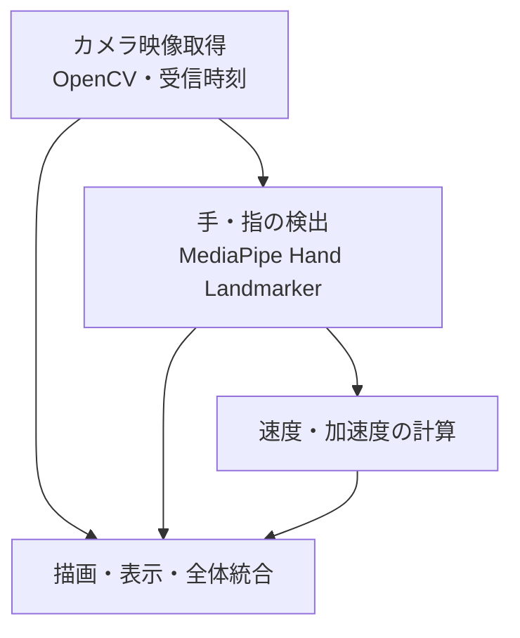

# 設計書（初版）

> 対象：カメラ映像から手・指の位置・速度・加速度を取得する機能  
> 状態：実装前の設計方針．具体的な内部構造やインターフェースは実装に応じて調整する．  
> 根拠：[Issue #4](https://github.com/marmotech/gosz_hand-motion-tracker/issues/4) と共通仕様①〜⑥の決定コメント．

## 1. 目的と対象範囲

カメラ映像からMediaPipe Hand Landmarkerで手の動きを検出し，各指先の位置・速度・加速度を画像上の2D量として取得・表示する．ピアノ演奏中の手・指の動きを観察することを想定する．

初版の対象は以下とする．

- カメラ映像と取得時刻の記録
- 左右両手の21点のランドマーク検出と5本の指先の識別
- 指先の2D位置・速度・加速度の計算
- ランドマークと計算結果の描画・表示

実空間での3D位置・速度・加速度，平滑化，計測結果の永続保存は初版の範囲外とし，必要に応じて別途検討する．

## 2. 処理構成



| 担当 | 責務 | Issue |
|---|---|---|
| カメラ取得 | フレーム取得，受信時刻記録，カメラ解放 | [#5](https://github.com/marmotech/gosz_hand-motion-tracker/issues/5) |
| 検出 | 両手のランドマーク取得，左右・指先の識別，検出失敗の扱い | [#6](https://github.com/marmotech/gosz_hand-motion-tracker/issues/6) |
| 運動計算 | 指先の速度・加速度，未計算値，最後の有効値の管理 | [#7](https://github.com/marmotech/gosz_hand-motion-tracker/issues/7) |
| 表示・統合 | 画像への描画，数値表示，各処理の結合，実行手順 | [#8](https://github.com/marmotech/gosz_hand-motion-tracker/issues/8) |

上図は論理的なデータの流れであり，クラス構成やファイル分割を指定するものではない．

## 3. 検出対象と座標系

- 両手に対応し，左右はMediaPipeのhandednessを利用して区別する．初版では独自の追跡・同一性判定は行わない．
- 手ごとに21点のランドマークを取得し，親指・人差し指・中指・薬指・小指の指先を識別する．
- 計算には入力画像の2D座標を使う．原点は左上，右が+x，下が+y．
- 位置は浮動小数点のpx，速度はpx/s，加速度はpx/s²とする．
- 表示時に画像を縮小・左右反転する場合は描画座標を変換するが，計算用座標には影響させない．
- 現在と過去の位置は，同じ座標系・単位で比較する．

出典：[共通仕様①](https://github.com/marmotech/gosz_hand-motion-tracker/issues/4#issuecomment-6413161335)，[共通仕様②](https://github.com/marmotech/gosz_hand-motion-tracker/issues/4#issuecomment-6413408596)．

## 4. 時刻と経過時間

- フレーム取得に成功した直後（`cap.read()` の成功直後）に `time.monotonic_ns()` を呼ぶ．
- タイムスタンプはナノ秒単位の整数でフレームとともに後続処理へ渡す．
- 固定FPSから経過時間を推定しない．
- 速度・加速度の計算処理が，実際に比較する観測値に対応するタイムスタンプから経過時間を算出する．

```python
dt = (current_timestamp_ns - previous_timestamp_ns) / 1_000_000_000
```

ここでの時刻は撮影時刻そのものではなく，アプリがフレームを受け取った時刻である．カメラ側の撮影時刻を利用する方法は将来検討する．

出典：[共通仕様③](https://github.com/marmotech/gosz_hand-motion-tracker/issues/4#issuecomment-6441191905)．

## 5. 速度・加速度と未計算値

- 各指先について，速度は `vx`，`vy`，加速度は `ax`，`ay` の2Dベクトル成分で表す．
- ベクトルの大きさは必要な箇所で算出する．
- 初めて位置を取得した時点では速度・加速度を `None` とする．
- 速度だけ計算できる時点では加速度を `None` とする．
- 計算不能の場合は成分ごとに欠損を表すのではなく，ベクトル全体を `None` とする．
- 位置取得と運動計算は分離する．将来，計算前に座標変換を追加できる余地を残す．

基本となる差分計算は以下のとおり．

```text
速度 = (現在の位置 - 比較対象の位置) / 対応する経過時間
加速度 = (現在の速度 - 比較対象の速度) / 対応する経過時間
```

出典：[共通仕様⑤](https://github.com/marmotech/gosz_hand-motion-tracker/issues/4#issuecomment-6510788494)．

## 6. 検出失敗時の扱い

- 左右の手について，最後に有効だった位置・速度と，それぞれに対応する時刻を独立して保持する．
- 検出に失敗したフレームの結果は `None` とし，保持中の最後の有効な値を `None` で上書きしない．
- 最後の有効な検出からの経過時間がしきい値以内なら，保持した値を使って再検出時に計算を再開する．
- しきい値を超えたら保持中の位置・速度・時刻をリセットし，再検出を新しい計測系列の開始として扱う．
- 検出できなかった区間の位置・速度・加速度は推測して補完しない．
- しきい値は設定で変更可能とし，初期値は**暫定100ms**とする．フレーム数ではなく経過時間で判定する．
- リセット対象は次回の計算に用いる最後の有効な値であり，すでに記録・保存した計測結果の削除を意味しない．

欠落区間をまたぐ速度はその区間の平均速度であり，瞬間的な打鍵速度とは限らない．

出典：[共通仕様⑥](https://github.com/marmotech/gosz_hand-motion-tracker/issues/4#issuecomment-6511155613)．

## 7. データ受け渡しと実装の自由度

- 各処理は必要な入力を受け取り，結果を関数・メソッドの戻り値で返す．処理間のデータ共有のためにグローバル変数は使わない．
- 共通仕様④では，処理間で受け渡すデータに `dataclass` を採用し，共通定義をimportする方針を決定している．
- ただし，具体的なクラス名・フィールド・内部の保持方法は未確定．DTO専用クラスを多数設けることは前提としない．
- 実装担当者は内部構造を自由に設計できる．処理間の受け渡しに必要な最小限の型・項目は，結合時に各担当間で整合させる．

**要確認：** 共通仕様④の「共通の`dataclass`定義を用意する」という決定と，その後の「具体的なデータ構造は各実装に任せる」という進め方の境界は，実装時に確認する．本書では新たなクラス構造を確定しない．

出典：[共通仕様④](https://github.com/marmotech/gosz_hand-motion-tracker/issues/4#issuecomment-6484132436)．

## 8. 未決定・検証事項

- 使用するカメラの選定，撮影タイムスタンプを取得できるか
- `dataclass` の具体的な構成と処理間の最小インターフェース
- 100msの保持時間が実際のフレームレート・検出品質に適切か
- 検出失敗後の再検出における手の取り違えなど，独自追跡をしないことによる制約
- 画面上の数値配置など，表示UIの詳細
- 実空間座標への変換，平滑化，計測結果の保存（将来の検討対象）

## 9. 関連Issue

- [#4 カメラ映像から手・指の位置・速度・加速度を取得する](https://github.com/marmotech/gosz_hand-motion-tracker/issues/4)
- [#5 カメラ映像とタイムスタンプを取得する](https://github.com/marmotech/gosz_hand-motion-tracker/issues/5)
- [#6 MediaPipeで両手のランドマークと指先座標を検出する](https://github.com/marmotech/gosz_hand-motion-tracker/issues/6)
- [#7 指先の速度・加速度を計算する](https://github.com/marmotech/gosz_hand-motion-tracker/issues/7)
- [#8 手・指の検出結果と運動情報を描画・表示して統合する](https://github.com/marmotech/gosz_hand-motion-tracker/issues/8)
